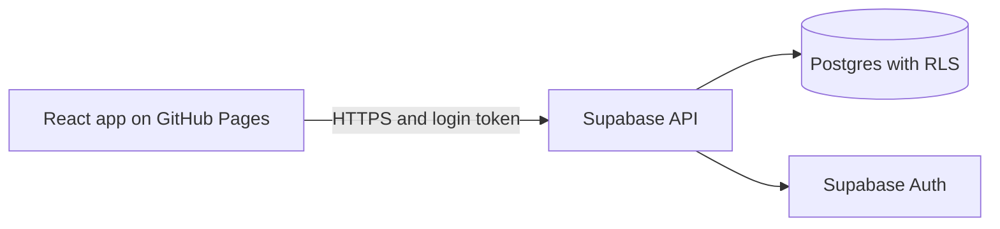

# TopoPlan


A shared project planner for small teams. It draws one timeline (a Gantt chart), finds the **critical path** (the chain of tasks that decides the finish date), and lets a team work on it together online, with an admin in charge of the plan and members in charge of their own tasks.

Everything runs in the browser. There is no server of our own: the app talks straight to Supabase, and the database rules decide who can do what.

## The idea

Most small team projects fail the same way: nobody knows which task is holding everyone up. TopoPlan answers that. Tasks depend on each other, the app works out which ones have no spare time ("critical") and which have a buffer, and when something slips, everything that waits on it moves too.

Teams share one timeline per project. An admin owns the plan. Members own their own tasks: they update progress, and if they need more time, they ask the admin instead of quietly missing the date.

## Objectives

- Show one shared timeline per project that the whole team can see.
- Find the critical path automatically and show each task's buffer.
- Keep the plan consistent: a task can never start before the tasks it depends on finish, and moving a task moves the tasks that wait for it.
- Let several people use it online, with separate accounts and separate projects.
- Give the right power to the right person: admins edit the plan, members update only the tasks assigned to them.
- Let members ask for status changes and date changes, and let admins approve or deny them, inside the app.
- Stay free and simple to run (static hosting plus a free database tier).

## Scope

**In scope**
- Accounts (sign up, log in, change name and password)
- Projects, invites by link or code, and admin and member roles
- Tasks with dates, priority, an assigned person and a dependency
- Timeline with critical path and buffer, plus a dashboard of task lists
- Status and date-change requests from the assigned person, approved or denied by admins
- Online hosting on GitHub Pages with Supabase as the backend

**Out of scope for now**
- A custom backend server
- Skipping weekends and holidays
- Real-time live updates (the app has a Refresh button and checks for new requests every 30 seconds)
- Email-based features such as notifications by email
- Mobile apps

## Features

| Area | What it does |
|---|---|
| Timeline | Gantt chart from today to the end of the latest task (at least 7 days, up to 180). It scrolls sideways and the task column stays in view. Dark bars are critical tasks, light bars have buffer |
| Critical path | Forward and backward pass over the task graph, buffer (slack) shown per task |
| Rescheduling | A task starts the day after its dependency ends. Moving a task by a day moves everything that waits for it |
| Dashboard | Four lists: Ready to start, Underway, Coming later, Completed this week |
| Task popup | Click any task to see who it is assigned to, whether it is critical, its dates and status, and to ask an admin for a status change or an extension |
| Team tab | Everyone in the project with their role and their tasks |
| Status | Waiting, Underway, Complete, colour coded. The assigned member asks, and an admin approves |
| Requests | Status changes and date changes (one day later or earlier) are asked by the assigned member and approved or denied by an admin, in the Requests tab or the task popup |
| Teams | Invite links that work once and expire after 7 days, for a member or an admin |
| Profile | Lists every project you are in with your role in each, plus change name and password |
| Multi project | One person can be an admin in one project and a member in another |

## Roles and permissions

| Action | Admin | Member |
|---|---|---|
| See the dashboard and the timeline | yes | yes |
| Add tasks, move dates, change who a task is assigned to | yes | no |
| Change a task's status | directly, if it is assigned to them | asks an admin to approve, on their own tasks only |
| Ask for an extension (a day later or earlier) | not needed (can edit dates) | on their own tasks only |
| Approve or deny requests | yes | no |
| Make invites | yes | no |

The buttons are hidden for people who cannot use them, but the real protection is in the database (see Security).

## Tech stack

| Layer | Choice |
|---|---|
| Frontend | React with Vite (JavaScript) |
| Hosting | GitHub Pages (static files) |
| Backend | Supabase: Postgres database, built-in login, auto-generated API |
| Access rules | Postgres Row Level Security (RLS) and a few database functions |
| Tests | Vitest (critical path engine) |



## How the scheduling works

The engine takes each task as a length in days plus a list of tasks it depends on.

1. Topological sort: orders the tasks and throws an error on circular dependencies.
2. Forward pass: the earliest start of each task.
3. Backward pass: the latest start that does not delay the project.
4. Buffer (slack) = latest start minus earliest start. A buffer of 0 means the task is critical.

On top of that, `schedule.js` pushes any task that starts before its dependency ends, and `shiftTask` moves a task and the tasks that wait for it. Weekends count as normal days.

## Data model

```
users      id, name                              (one per login)
projects   id, name
roles      user_id, project_id, role             (admin or member, one row per person per project)
invites    code, project_id, role, expires_at, used_by
tasks      id, project_id, name, assigned_to, start_date, end_date,
           priority, depends_on, status, finished_at
requests   id, project_id, task_id, requested_by, kind (status or extension),
           days (1 or -1), new_status, reason, status (pending, approved, denied)
```

Email and password live in Supabase's private `auth.users` table, which the app cannot read. The `users` table above holds only the display name.

## Security

- Only the public (anon) key is in the app. The secret `service_role` key is never used in the browser.
- Row Level Security is on for every table. People only see projects they belong to, and only admins can write tasks or invites.
- Joining a project only works through a valid invite code. Nobody can add themselves or make themselves an admin.
- A database trigger makes sure a task's status only changes through an approved request (or directly by an admin who is assigned to it), even if someone calls the database directly.
- Invite codes work once and expire after 7 days.
- Passwords are handled and hashed by Supabase. Sign-up requires email confirmation.

## Project structure

```
supabase/
  schema.sql              full database setup (wipes and rebuilds the tables)
client/
  .env                    your Supabase keys (never commit this)
  src/
    App.jsx               login state, project switcher, top bar
    supabase.js           the Supabase connection
    db.js                 every database call
    labels.js             status words and small helpers
    pages/                Login, SignUp, TeamSetup, Project, Dashboard,
                          Home (timeline), Team, Requests, Profile
    components/           AddTask, TaskDetails
    engine/               graph.js, cpm.js, schedule.js, cpm.test.js
```

## Run it

1. Create a free project at supabase.com.
2. In the Supabase SQL Editor, paste and run `supabase/schema.sql`. This wipes and rebuilds the tables, so use it only on a new or test database.
3. Create `client/.env`:
   ```
   VITE_SUPABASE_URL=your-project-url
   VITE_SUPABASE_ANON_KEY=your-anon-or-publishable-key
   ```
4. Make sure `.env` is listed in `.gitignore`.
5. Start the app:
   ```bash
   cd client
   npm install
   npm run dev
   ```
6. Run the engine tests with `npm test` inside `client/`.

## Deploying to GitHub Pages (planned)

- Set `base: '/your-repo-name/'` in `vite.config.js`.
- Build and publish with a GitHub Actions workflow.
- Add the two `VITE_` values as repository secrets so the build can read them.
- In Supabase, set the Site URL (Authentication, then URL Configuration) to the GitHub Pages address, or confirmation emails will link to the wrong place.

## Troubleshooting

- **"Email rate limit exceeded":** Supabase's built-in email sender allows only a few emails per hour. For testing, create users by hand in the dashboard (Authentication, then Users, tick Auto Confirm) or turn off Confirm email temporarily. For real use, set up custom SMTP.
- **"Could not find the table ... in the schema cache":** the SQL did not finish running, or the app is pointed at a different Supabase project. Re-run the SQL and check `client/.env`. If needed run `notify pgrst, 'reload schema';`.

## Current status

**Built and checked by running it**
- Critical path engine with unit tests
- Timeline, rescheduling, slipping a task together with its dependents
- Sign up and log in with Supabase
- Projects, invite links, admin and member roles, multi-project profile
- Dashboard lists, member names in the assignee dropdown

**Built, but not yet tested end to end**
- Assigning tasks to a person (instead of typing a name)
- Status changes that need admin approval
- Colour-coded statuses and the new labels (Waiting, Underway, Complete)
- The task popup (click a task) and the Team tab
- Status and date-change requests, and the Requests tab for admins

These need a fresh run of `supabase/schema.sql`, which rebuilds the tables (logins are kept).

**Not done yet**
- GitHub Pages deployment and the Actions workflow
- Custom SMTP for sign-up emails
- Tests for `reschedule` and `shiftTask`
- Live updates instead of Refresh
- Deleting tasks, leaving a project, removing members, changing email

## Roadmap

- Test the request flow with two accounts, then deploy to GitHub Pages
- Add custom SMTP so sign-up emails do not hit the rate limit
- Tests for the scheduling code
- Skip weekends and holidays
- Live updates
- Undo
- Delete tasks and manage team members

## License

[MIT License](LICENSE) 2026 venz-ochoa